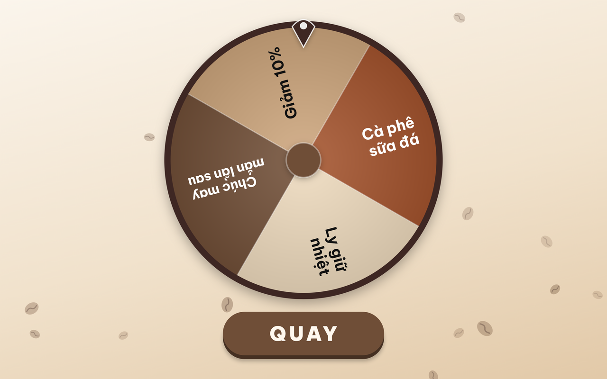
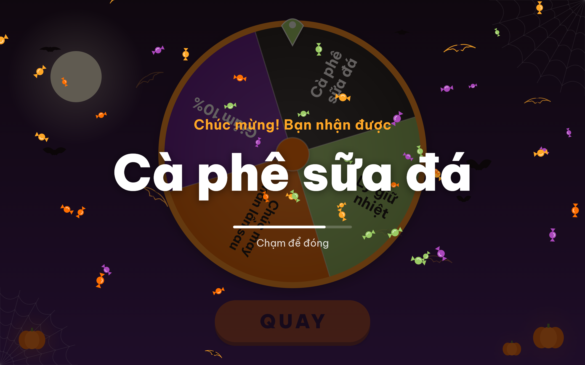
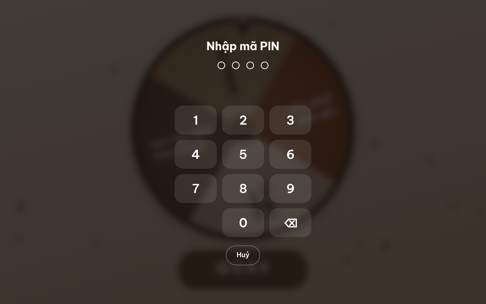
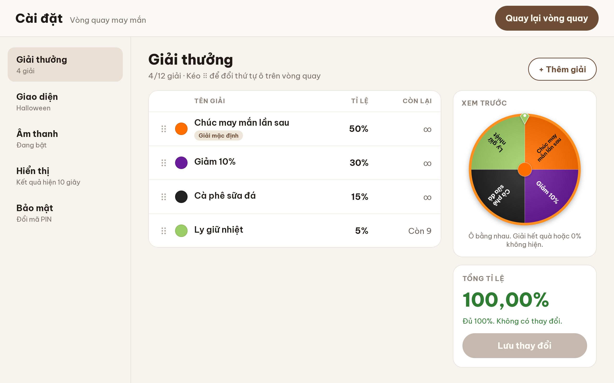
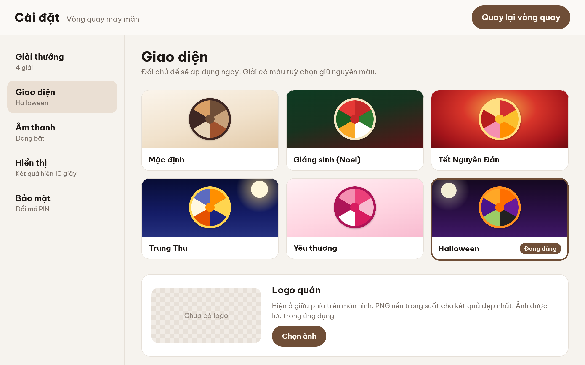
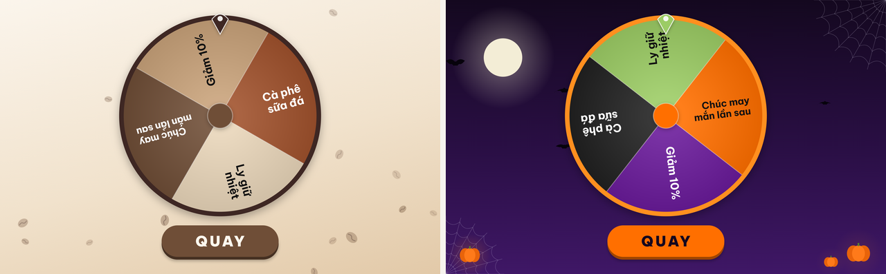

# Vòng quay may mắn · Café Lucky Wheel

[English](#english) · [Tiếng Việt](#tiếng-việt)

---

## English

Café Lucky Wheel is a prize wheel for cafés, made for an Android tablet at the counter. Customers see a full-screen wheel and spin it. The owner sets up the prizes, their chances and how many of each are left, plus the café logo and a seasonal theme, in a Settings area protected by a PIN.

The app works fully offline. It has no internet access, no accounts and no tracking, and everything stays on the tablet. The customer screen is in Vietnamese.

### Disclaimer

- This app is a promotional tool for giving customers free gifts and discounts. **It is not gambling.** It takes no bets, money or payment of any kind, and it must not be used for gambling or betting.
- The software is provided "as is", without warranty of any kind. The authors accept no responsibility or liability for how anyone uses it, or for any loss, dispute or claim arising from its use.
- If you run a prize draw with it, you are responsible for following the laws where you operate, including any rules on promotions and lucky draws.

### Installing

- You need an Android tablet running **Android 13 or newer**. It also runs on phones, which is handy for trying it out.
- **Easiest:** copy [`releases/app-debug.apk`](releases/app-debug.apk) to the tablet and open it. Allow installing apps from this source if Android asks.
- **Or build it from this repository:**
  - **Android Studio:** open the `android/` folder and press **Run** with the tablet connected.
  - **Command line:** `cd android && ./gradlew installDebug` installs it on the connected tablet. `./gradlew assembleDebug` builds `android/app/build/outputs/apk/debug/app-debug.apk` for you to copy over and install.
- The app appears on the tablet as **Vòng quay may mắn**.

### 1. First launch: create the PIN

The first time the app opens, it asks you to create a **4-digit PIN** for Settings. Enter it twice to confirm. If the two entries don't match, start again.

> **Keep the PIN safe.** If you forget it, the only way back in is to clear the app's data. Open Android **Settings › Apps › Vòng quay may mắn › Storage › Clear storage**; the exact menu names vary by device. That deletes the PIN, prizes, logo and all settings.

After the PIN is set, the wheel appears with four sample prizes so you can try it straight away. You can change them in Settings.

### 2. Spinning the wheel (for customers)

- Tap **QUAY** ("Spin"), or flick the wheel with a finger.
- A gentle swipe doesn't spin: the wheel just springs back. Flick harder to spin.
- A stronger flick spins longer, but it **does not change the result**. Neither the button nor the flick can influence which prize comes up. The prize is drawn at random from the chances you set, the moment the spin starts.
- When the wheel stops, the prize appears in large text with a celebration effect and sound. Tap anywhere to close it, or wait; it closes by itself after 10 seconds, which you can change. Staff hand over whatever prize is shown on screen.

**How quantities work**

- When a prize with a limited quantity is won, its remaining count goes down by one as the result is shown.
- When a prize runs out, its slice disappears from the wheel. Its chance moves to the default prize **"Chúc may mắn lần sau"** ("Better luck next time"), so the total stays 100%.
- If every real prize has run out, the wheel turns grey and shows **"Đã hết quà"** ("Out of prizes"). Spinning stays off until you restock in Settings.

### 3. Opening Settings (for the owner)

1. **Press and hold the top-left corner of the screen for 3 seconds.** Nothing on screen points to this spot, so customers won't stumble on it. A small ring fills up while you hold.
2. Enter your PIN.

- After **5 wrong PINs**, entry is locked for **30 seconds**. The lock still applies if the app is restarted.
- The corner doesn't respond while the wheel is spinning or a result is showing.
- Settings **closes by itself** after 2 minutes without a touch. It also closes, and asks for the PIN again, as soon as you leave the app (Home button, recent apps or another app).
- **Quay lại vòng quay** ("Back to the wheel") at the top right returns to the customer screen.

### 4. Prizes (Giải thưởng)

The list shows each prize's colour, name, chance (**Tỉ lệ**) and how many are left (**Còn lại**; ∞ means unlimited). On the right, **Xem trước** ("Preview") shows how the wheel will look.

- **Add a prize:** tap **+ Thêm giải**. You can have up to 12 prizes, including the default prize.
- **Edit a prize:** tap its row. In the editor you can set:
  - **Tên giải** (name): up to 24 characters.
  - **Màu ô** (slice colour): **Theo chủ đề** follows the theme's colours; **Tuỳ chọn** lets you pick one of 12 colours or **Màu khác** for any colour.
  - **Tỉ lệ trúng** (chance to win): 0 to 100%, with up to 2 decimals. A comma or a dot both work, for example `12,5`.
  - **Số lượng còn lại** (remaining quantity): **Không giới hạn** (unlimited) or **Giới hạn** (limited), set with − / +.

  Tap **Xong** ("Done") to apply the change to the list, or **Xoá giải** to delete the prize.
- **Change the order:** drag the ⠿ handle. The list order is the order of the slices on the wheel.
- **The default prize** (marked **Giải mặc định**, "Chúc may mắn lần sau" at first) is always unlimited and can't be deleted. You can rename it and change its chance.
- **Saving:** changes take effect only when you tap **Lưu thay đổi** ("Save changes"). **Bỏ thay đổi** throws them away.
  - Saving is allowed only when the chances add up to **exactly 100,00%**. If they don't, **Tổng tỉ lệ** ("Total") shows how much is missing or over.
  - At least two prizes must have a chance above 0%.
- **Restocking:** edit the prize's quantity and save. The slice comes back on the wheel straight away.
- Labels on the list:
  - **Hết quà**: out of stock.
  - **Không hiện trên vòng**: 0%, not shown on the wheel.
  - **Màu tuỳ chọn**: custom colour.
- Every slice on the wheel is the same size. **A slice's size says nothing about its chance**; only the percentage does.

### 5. Appearance (Giao diện)

- **Themes:** there are six:
  - **Mặc định** (default, coffee)
  - **Giáng sinh (Noel)** (Christmas)
  - **Tết Nguyên Đán** (Lunar New Year)
  - **Trung Thu** (Mid-Autumn)
  - **Yêu thương** (Love: Valentine's Day, 8/3, 20/10)
  - **Halloween**

  Each theme changes the background, the floating decorations, the wheel colours, the win effect and the sounds, and applies immediately. Prizes with a custom colour keep that colour.
- **Logo quán** (café logo): tap **Chọn ảnh** ("Choose image") and pick a picture. A PNG with a transparent background looks best. The logo is shown at the top centre of the customer screen. It is copied into the app, so deleting the original photo later is fine. Use **Đổi logo** to change it or **Xoá logo** to remove it.
- **Hình nền tuỳ chỉnh** (custom background): use your own photo instead of the theme's background. The theme's colours, effects and sounds stay, and a light overlay keeps the wheel easy to read. **Dùng nền chủ đề** ("Use the theme background") switches back.
- **Hiện hiệu ứng trang trí** (show decorations): turn the floating decorations off, for example when your background photo is already busy.

### 6. Sound, display and security

- **Âm thanh** (sound): turn sounds on or off. The app uses the tablet's media volume. **Nghe thử: trúng giải** and **Nghe thử: chúc may mắn** play the win and "better luck next time" sounds so you can check the volume.
- **Hiển thị** (display):
  - **Thời gian hiển thị kết quả** (result display time): 3 to 60 seconds; the default is 10.
  - **Giữ màn hình luôn sáng** (keep the screen on): keeps the screen on while the wheel is showing.
- **Bảo mật** (security): **Đổi mã PIN** changes the PIN. Enter the current PIN, then the new one twice.

### Tips

- The app doesn't lock the tablet. A customer can still swipe from the edge to bring up the system bars. To keep customers inside the app, you can use Android's own **App pinning** (Settings › Security); its location varies by device.
- Leave the tablet plugged in. With **Giữ màn hình luôn sáng** on, the screen stays awake all day.
- Everything is stored only on the tablet. There is no backup or sync, so note down your prize setup somewhere if you'd need to recreate it.

### For developers

- The stack is Kotlin, Jetpack Compose, Room and DataStore, with a single Gradle module in `android/`.
- To build and test, run from `android/`:
  - `./gradlew assembleDebug` builds the app.
  - `./gradlew testDebugUnitTest` runs all tests, including the UI tests, on the JVM with Robolectric.
  - `./gradlew lintDebug` runs lint.
- The sound effects are generated by [`tools/generate_sounds.py`](tools/generate_sounds.py).
- The font is Be Vietnam Pro, under the SIL Open Font License ([licence](licenses/BeVietnamPro-OFL.txt)).

---

## Tiếng Việt

Vòng quay may mắn là ứng dụng quay thưởng dành cho quán cà phê, chạy trên máy tính bảng Android đặt ở quầy. Khách chỉ thấy vòng quay toàn màn hình và bấm quay. Chủ quán thiết lập giải thưởng, tỉ lệ trúng, số lượng còn lại, logo quán và chủ đề theo mùa trong phần Cài đặt được bảo vệ bằng mã PIN.

Ứng dụng chạy hoàn toàn ngoại tuyến: không cần internet, không tài khoản, không theo dõi, mọi dữ liệu đều nằm trên máy.

### Miễn trừ trách nhiệm

- Ứng dụng này là công cụ khuyến mại để tặng quà và giảm giá miễn phí cho khách. **Đây không phải là trò chơi cá cược.** Ứng dụng không nhận tiền đặt cược hay bất kỳ khoản thanh toán nào, và không được dùng vào mục đích cờ bạc hoặc cá cược.
- Phần mềm được cung cấp "nguyên trạng", không kèm bất kỳ bảo đảm nào. Tác giả không chịu trách nhiệm về việc bất kỳ ai sử dụng ứng dụng, cũng như mọi thiệt hại, tranh chấp hay khiếu nại phát sinh từ việc sử dụng.
- Nếu tổ chức quay thưởng bằng ứng dụng này, bạn tự chịu trách nhiệm tuân thủ pháp luật nơi mình hoạt động, kể cả các quy định về khuyến mại và chương trình may rủi.

### Cài đặt

- Cần máy tính bảng Android **13 trở lên**. Ứng dụng cũng chạy được trên điện thoại để thử.
- **Cách nhanh nhất:** chép file [`releases/app-debug.apk`](releases/app-debug.apk) sang máy tính bảng rồi mở để cài. Nếu Android hỏi, hãy cho phép cài ứng dụng từ nguồn này.
- **Hoặc build từ kho mã này:**
  - **Android Studio:** mở thư mục `android/` và bấm **Run** khi đã cắm máy tính bảng.
  - **Dòng lệnh:** `cd android && ./gradlew installDebug` cài thẳng lên máy đang cắm. `./gradlew assembleDebug` tạo file `android/app/build/outputs/apk/debug/app-debug.apk` để chép sang máy và cài.
- Trên máy, ứng dụng có tên **Vòng quay may mắn**.

### 1. Lần mở đầu tiên: tạo mã PIN

Lần đầu mở, ứng dụng yêu cầu tạo **mã PIN 4 chữ số** cho phần Cài đặt. Nhập hai lần để xác nhận. Nếu hai lần không khớp, bạn sẽ tạo lại từ đầu.

> **Hãy nhớ mã PIN.** Nếu quên, cách duy nhất để vào lại là xoá dữ liệu của ứng dụng. Vào **Cài đặt Android › Ứng dụng › Vòng quay may mắn › Bộ nhớ › Xoá dữ liệu**; tên mục có thể khác nhau tuỳ máy. Thao tác này xoá mã PIN, giải thưởng, logo và mọi cài đặt.

Sau khi tạo PIN, vòng quay hiện ra với bốn giải mẫu để dùng thử ngay. Bạn có thể sửa chúng trong Cài đặt.

### 2. Quay thưởng (dành cho khách)

- Bấm **QUAY**, hoặc dùng ngón tay vuốt mạnh vòng quay.
- Vuốt nhẹ thì vòng chỉ nảy về chỗ cũ, không quay. Vuốt mạnh hơn để quay.
- Vuốt càng mạnh thì vòng quay càng lâu, nhưng **không làm thay đổi kết quả**. Nút bấm hay lực vuốt đều không ảnh hưởng tới giải trúng. Giải được bốc ngẫu nhiên theo tỉ lệ bạn đặt, ngay lúc vòng bắt đầu quay.
- Khi vòng dừng, tên giải hiện chữ lớn kèm hiệu ứng và âm thanh. Chạm vào màn hình để đóng, hoặc chờ; kết quả tự đóng sau 10 giây và bạn có thể chỉnh thời gian này. Nhân viên trao đúng giải đang hiện trên màn hình.

**Số lượng giải hoạt động thế nào**

- Mỗi lần trúng một giải có giới hạn số lượng, số còn lại giảm 1 ngay khi kết quả hiện ra.
- Khi một giải hết quà, ô của giải đó biến mất khỏi vòng quay. Tỉ lệ của nó được cộng vào giải mặc định **"Chúc may mắn lần sau"**, nên tổng vẫn là 100%.
- Khi mọi giải thật đều hết, vòng quay chuyển màu xám và hiện **"Đã hết quà"**. Không quay được cho tới khi bạn bổ sung số lượng trong Cài đặt.

### 3. Mở Cài đặt (dành cho chủ quán)

1. **Nhấn giữ góc trên bên trái màn hình trong 3 giây.** Trên màn hình không có gì chỉ ra vị trí này, nên khách khó vô tình mở được. Khi bạn giữ, một vòng tròn nhỏ sẽ đầy dần.
2. Nhập mã PIN.

- Nhập sai **5 lần** thì phải chờ **30 giây** mới nhập lại được. Khoá này vẫn còn kể cả khi mở lại ứng dụng.
- Góc này không phản hồi khi vòng đang quay hoặc đang hiện kết quả.
- Cài đặt **tự đóng** sau 2 phút không chạm. Nó cũng đóng và hỏi lại mã PIN ngay khi bạn rời ứng dụng (nút Home, danh sách ứng dụng gần đây hoặc mở ứng dụng khác).
- Nút **Quay lại vòng quay** ở góc trên bên phải đưa bạn về màn hình của khách.

### 4. Giải thưởng

Danh sách hiển thị màu, tên, **Tỉ lệ** và **Còn lại** (∞ là không giới hạn) của từng giải. Ô **Xem trước** bên phải cho thấy vòng quay sẽ trông thế nào.

- **Thêm giải:** bấm **+ Thêm giải**. Tối đa 12 giải, kể cả giải mặc định.
- **Sửa giải:** chạm vào dòng của giải. Trong cửa sổ sửa có:
  - **Tên giải:** tối đa 24 ký tự.
  - **Màu ô:** **Theo chủ đề** dùng màu của chủ đề; **Tuỳ chọn** cho chọn một trong 12 màu, hoặc **Màu khác** để chọn màu bất kỳ.
  - **Tỉ lệ trúng:** từ 0 đến 100%, tối đa 2 chữ số thập phân. Dùng dấu phẩy hay dấu chấm đều được, ví dụ `12,5`.
  - **Số lượng còn lại:** **Không giới hạn** hoặc **Giới hạn**, chỉnh bằng nút − / +.

  Bấm **Xong** để đưa thay đổi vào danh sách, hoặc **Xoá giải** để xoá.
- **Đổi thứ tự:** kéo tay nắm ⠿. Thứ tự trong danh sách chính là thứ tự các ô trên vòng quay.
- **Giải mặc định** (có nhãn **Giải mặc định**, ban đầu là "Chúc may mắn lần sau") luôn không giới hạn và không thể xoá. Bạn có thể đổi tên và tỉ lệ của nó.
- **Lưu:** thay đổi chỉ có hiệu lực khi bấm **Lưu thay đổi**. **Bỏ thay đổi** sẽ huỷ các chỉnh sửa.
  - Chỉ lưu được khi tổng tỉ lệ **đúng 100,00%**. Nếu chưa đúng, ô **Tổng tỉ lệ** cho biết còn thiếu hay vượt bao nhiêu.
  - Phải có ít nhất 2 giải có tỉ lệ lớn hơn 0%.
- **Bổ sung quà:** sửa số lượng của giải rồi lưu. Ô của giải xuất hiện lại trên vòng quay ngay.
- Các nhãn trong danh sách:
  - **Hết quà:** giải đã hết.
  - **Không hiện trên vòng:** tỉ lệ 0%, không có ô trên vòng quay.
  - **Màu tuỳ chọn:** giải dùng màu riêng.
- Mọi ô trên vòng quay đều bằng nhau. **Kích thước ô không thể hiện tỉ lệ trúng**; chỉ con số phần trăm mới quyết định.

### 5. Giao diện

- **Chủ đề:** có sáu chủ đề:
  - **Mặc định** (cà phê)
  - **Giáng sinh (Noel)**
  - **Tết Nguyên Đán**
  - **Trung Thu**
  - **Yêu thương** (Valentine, 8/3, 20/10)
  - **Halloween**

  Mỗi chủ đề đổi hình nền, hiệu ứng trang trí, màu vòng quay, hiệu ứng khi trúng và âm thanh, và áp dụng ngay. Giải có màu tuỳ chọn vẫn giữ nguyên màu.
- **Logo quán:** bấm **Chọn ảnh** và chọn hình. Ảnh PNG nền trong suốt cho kết quả đẹp nhất. Logo hiện ở giữa phía trên màn hình của khách. Ảnh được chép vào ứng dụng, nên xoá ảnh gốc trong thư viện cũng không sao. Dùng **Đổi logo** để thay hoặc **Xoá logo** để bỏ.
- **Hình nền tuỳ chỉnh:** dùng ảnh của bạn thay cho hình nền của chủ đề. Màu vòng quay, hiệu ứng và âm thanh vẫn theo chủ đề, và một lớp phủ nhẹ giúp vòng quay luôn dễ nhìn. **Dùng nền chủ đề** để quay lại hình nền gốc.
- **Hiện hiệu ứng trang trí:** tắt các hiệu ứng bay lượn, ví dụ khi hình nền tuỳ chỉnh đã nhiều chi tiết.

### 6. Âm thanh, hiển thị và bảo mật

- **Âm thanh:** bật hoặc tắt âm thanh. Ứng dụng dùng âm lượng media của máy. Hai nút **Nghe thử: trúng giải** và **Nghe thử: chúc may mắn** phát âm thanh trúng giải và "chúc may mắn lần sau" để bạn chỉnh âm lượng.
- **Hiển thị:**
  - **Thời gian hiển thị kết quả:** từ 3 đến 60 giây; mặc định 10 giây.
  - **Giữ màn hình luôn sáng:** màn hình không tắt khi đang hiện vòng quay.
- **Bảo mật:** **Đổi mã PIN** để đổi mã. Nhập mã hiện tại, sau đó nhập mã mới hai lần.

### Mẹo sử dụng

- Ứng dụng không khoá máy tính bảng. Khách vẫn có thể vuốt từ mép màn hình để hiện thanh hệ thống. Nếu muốn giữ khách trong ứng dụng, hãy dùng tính năng **Ghim ứng dụng** có sẵn của Android (trong Cài đặt › Bảo mật; vị trí có thể khác tuỳ máy).
- Nên cắm sạc cho máy. Khi bật **Giữ màn hình luôn sáng**, màn hình sẽ sáng suốt cả ngày.
- Mọi dữ liệu chỉ nằm trên máy, không có sao lưu hay đồng bộ. Hãy ghi lại danh sách giải ở đâu đó nếu bạn cần thiết lập lại.

### Dành cho lập trình viên

- Công nghệ: Kotlin, Jetpack Compose, Room và DataStore, với một module Gradle duy nhất trong `android/`.
- Để build và kiểm thử, chạy trong thư mục `android/`:
  - `./gradlew assembleDebug` để build ứng dụng.
  - `./gradlew testDebugUnitTest` để chạy toàn bộ kiểm thử, kể cả kiểm thử giao diện, trên JVM bằng Robolectric.
  - `./gradlew lintDebug` để chạy lint.
- Âm thanh được tạo bằng [`tools/generate_sounds.py`](tools/generate_sounds.py).
- Phông chữ Be Vietnam Pro dùng giấy phép SIL Open Font License ([giấy phép](licenses/BeVietnamPro-OFL.txt)).
